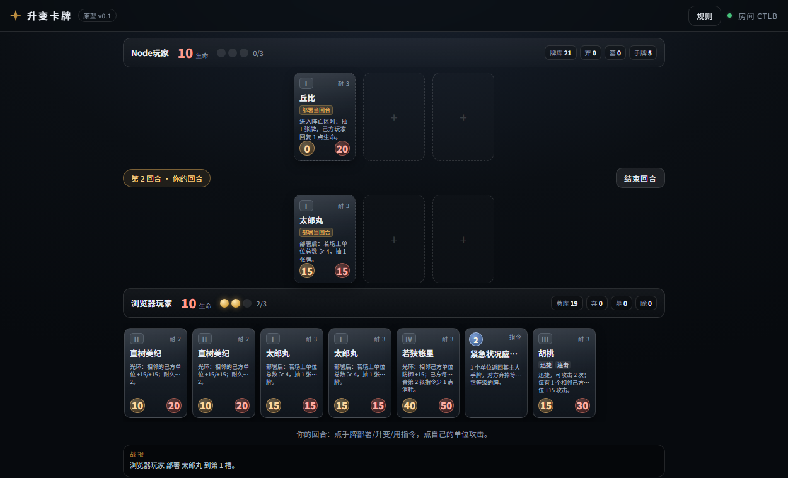
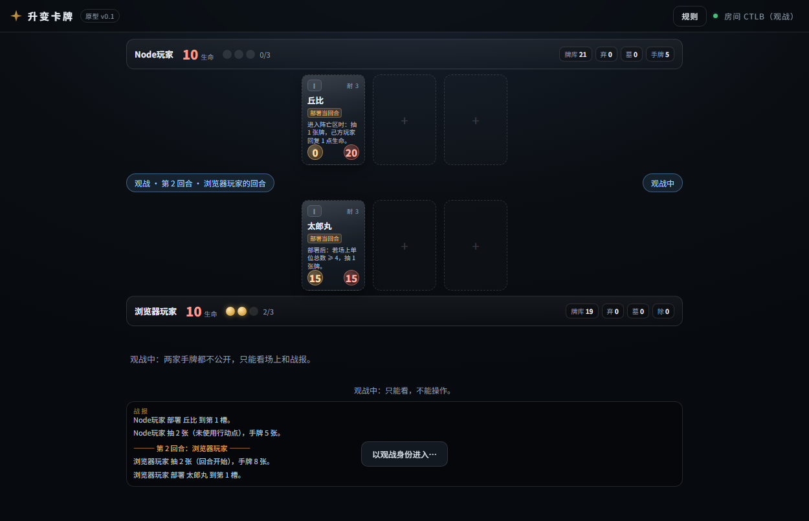
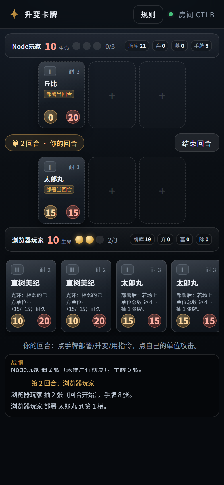

# 升变卡牌 · 可联机原型 v0.1

[](https://github.com/Yukinooshita/sheng-bian-card-game/actions/workflows/test.yml)
[](https://github.com/Yukinooshita/sheng-bian-card-game/releases)
[](LICENSE)
[](CONTRIBUTING.md)

一个按手写规则做成的 1v1 卡牌对战原型：**浏览器打开就能打**，两个人在不同设备上联机，规则数值与卡池都能自己改。零依赖，服务端权威，带机器人自测和观战。



- **不需要 `npm install`**：只用 Node 自带模块（HTTP + 自己写的 WebSocket）
- **不需要上架**：双击 `启动游戏.bat` 就是一台服务器，网址发给朋友就开局
- **服务端权威**：部署、升变、攻击、伤害全部在服务器判定，改前端改不出作弊
- **8 套卡组**：炎 / 森 / 影 / 小圆 / 海贼王 / 孤独摇滚 / 结城友奈 / 学院孤岛

| 观战 | 手机 |
| --- | --- |
|  |  |

---

## 快速开始

### 方式一：下载整合包（Windows，最省事）

到 [**Releases**](https://github.com/Yukinooshita/sheng-bian-card-game/releases) 下载 `sheng-bian-v0.1.0-win-x64.zip`（已内置 Node 运行时，解压即玩）：

1. 解压到任意位置（别只解压到 C 盘根目录）。
2. 双击 **`启动游戏.bat`**，窗口里会打印本机与局域网网址。
3. 浏览器打开 `http://localhost:8080`。
4. 一个人先试：开两个标签页，一个"创建房间"，另一个输房间码"加入"，各自选卡组 → 准备 → 开局。

### 方式二：clone 仓库 / 用 GitHub 下载源码

```bash
git clone https://github.com/Yukinooshita/sheng-bian-card-game.git
```

`runtime/node.exe` **不在仓库里**（83MB 会让 clone 很难受，也不适合入库）。第一次双击 `启动游戏.bat` 时，它会自动调用 `get-node.ps1` 下载一次免安装 Node（约 34MB）到 `runtime/`，之后就不再下载。

也可以手动跑：

```powershell
powershell -NoProfile -ExecutionPolicy Bypass -File .\get-node.ps1
```

### 方式三：用系统 Node

```bash
node server.js 8080      # 或 npm start
```

### 和朋友玩

- 同一个 WiFi：把窗口里 `http://192.168.x.x:8080` 发给朋友，填 4 位房间码加入。
- 异地：房主做一次内网穿透（cpolar / natapp / ngrok），把公网网址发出去。
- 房间满了也能看：填房间码，点 **"观战"**——不占座位、看不到双方手牌、不能操作。

详细步骤（含防火墙、端口占用、部署到云服务器）见 **`使用说明.md`**。

---

## 规则速览

| 项 | 说明 |
| --- | --- |
| 卡组 | 24 张单位 + 3 张指令；牌库抽空时洗弃牌区回去 |
| 回合 | 每回合 3 行动点：部署 1、攻击 1、升变 1、指令按卡面消耗；剩余行动点可换抽牌 |
| 生命 | 玩家 10 点；单位攻击玩家按"单位等级"掉血；敌方场上有单位时不能打脸 |
| 等级 | Ⅰ 级直接部署；Ⅱ~Ⅴ 用升变：Ⅱ=Ⅰ×1；Ⅲ=Ⅰ×2 或 Ⅱ×1；Ⅳ=Ⅰ×3 或 Ⅲ×1；Ⅴ=Ⅱ×2 或 Ⅳ×1 |
| 槽位 | 3 个部署槽，升变后新单位落在材料的位置 |
| 耐久 | 单位每回合开始耐久 -1，归零进弃牌区；血量归零进阵亡区 |
| 取整 | 攻击/伤害/生命按 5 的倍数向上取整，上限 995 |
| 关键词 | 迅捷 / 连击 / 防御 / 反击 / 群攻 / 弹射 / 隐匿 / 冲击 / 追击 / 眩晕 / 凋亡 / 压制 / 装备 / 光环 / 唯一 / 亡计 / 除外回场 …（完整表见 `卡表.md`） |

已实现的功能清单与"故意先没做"的部分见下方表格。

<details>
<summary>已实现（点开）</summary>

| 规则 | 状态 |
| --- | --- |
| 24 单位 + 3 指令、抽牌/换牌、牌库抽空洗弃牌区 | ✅ |
| 行动点 3、部署/攻击/升变/指令消耗 | ✅ |
| 玩家 10 生命、按等级掉血、有单位时不能打脸 | ✅ |
| Ⅰ 级直接部署、Ⅱ~Ⅴ 按配方升变 | ✅ |
| 部署槽 3、部署当回合不能攻击（迅捷例外）、攻击后"已行动" | ✅ |
| 耐久每回合 -1、归零进弃牌区、血量归零进阵亡区 | ✅ |
| 防御 / 反击 / 群攻 / 弹射 / 隐匿 / 冲击 / 追击 / 眩晕 / 凋亡 | ✅ |
| 指令用后进弃牌区、同一指令第 3 次除外 | ✅ |
| 亡计：己方回合从阵亡区发动，结算后除外 | ✅ |
| 被攻击抽 1、回合结束剩点换抽牌、第 2 回合起每回合抽 2 | ✅ |
| 按 5 取整、超过 995 截断 | ✅ |
| 房间码联机、状态同步、断线/刷新回座位 | ✅ |
| 观战：多人围观、不占座位、看不到双方手牌 | ✅ |
| 装备 / 连击 / 相邻光环 / 唯一单位 / 压制 / 眩晕多回合 / 进墓触发 / 除外回场 / 衍生物 | ✅（第二批发掘的新卡组带进来的机制） |

</details>

<details>
<summary>故意留白 / 待确认（点开）</summary>

| 规则 | 为什么先留白 |
| --- | --- |
| 装置 | 关键字留了位，没有卡；改 `doDeploy`/`doAttack` 两处即可 |
| 逼制 | 层数与加费已实现，缺"怎么施加"的卡 |
| 放逐、召回、领队 | 手写原稿字迹/语义待确认 |
| "后发先至"、"部署时/部署后" 时点 | 需要触发栈，属于规则细化阶段 |
| 人机、账号、排行榜 | 下一阶段功能 |
| 卡组编辑器 | 现在加卡组要改文件 |

`规则原文整理.md` 第六节列了 9 处字迹取舍，改之前最好先跟作者确认。

</details>

---

## 目录结构

```
升变卡牌/
├─ 启动游戏.bat          Windows 双击即开服务器（缺 Node 时自动下载）
├─ 自测.bat              改完规则跑一遍
├─ get-node.ps1          下载免安装 Node 到 runtime/（runtime 不入库）
├─ AGENTS.md             给 AI 编码助手的项目约定（Cursor/Claude Code/Codex 会自动读）
├─ server.js             零依赖 HTTP + WebSocket：房间、座位、观战、重连
├─ engine/
│  ├─ config.js          所有数值（生命/行动点/槽位/抽牌/耐久/升变配方/取整）
│  ├─ cards.js           71 张卡 + 8 套卡组 + 关键词中文名
│  └─ engine.js          规则裁判：部署/升变/攻击/装备/效果结算/视角过滤
├─ public/
│  ├─ index.html         大厅 + 牌桌
│  ├─ style.css          深色牌桌、手机适配
│  └─ app.js             交互：选牌、选槽、选材料、选目标、战报
├─ test/
│  ├─ rules.js           基础规则 41 条断言
│  ├─ rules_new.js       新卡组/新机制 44 条断言
│  ├─ sim.js             机器人自动对局（8 套轮转）
│  ├─ net.js             真联机端到端 + 观战
│  ├─ cdp.js             无头 Edge 截图验收（需本机 Edge）
│  └─ export_cards.js    生成 卡表.md
├─ runtime/node.exe      本地运行时（git 忽略，首次运行自动下载）
├─ docs/screenshots/     README 用截图
├─ 规则原文整理.md        手写笔记的文字版 + 取舍说明
├─ 使用说明.md            怎么开、怎么联机、异地怎么办、怎么发给别人
├─ 修改指南.md            改数值/加卡/加卡组/加关键词
├─ 卡表.md               自动生成的完整卡表
└─ CONTRIBUTING.md       怎么一起改
```

---

## 测试

```bash
npm test                       # = 下面四条
node test/rules.js             # 41 条基础规则
node test/rules_new.js         # 44 条新机制
node test/sim.js 100           # 100 局机器人对局，查崩溃/非法状态
node test/net.js               # 建房→加入→开局→部署→拒绝非法攻击→重连→观战
```

Windows 也可以双击 `自测.bat`。界面改动想看图，跑 `node test/cdp.js`（会输出 4 张截图）。

CI：每次 push / PR 都会在 GitHub Actions 里跑上面四条（`.github/workflows/test.yml`）。

当前状态：`41 + 44 条断言通过`、`8 套卡组 200 局机器人对局全部正常结束（平均约 90 回合）`、`联机与观战测试通过`。

---

## 一起改

看 **`CONTRIBUTING.md`**。要点：

1. 从 `main` 切分支，一个 PR 只做一件事
2. 改卡池优先按卡组分工（`cards.js` 是单文件，容易冲突）
3. 加卡组后必须跑 `node test/export_cards.js` 重新生成 `卡表.md`
4. 提交前 `npm test`，挂了不合

想加的功能可以从 Issues 里挑，或者直接开个 Issue 说"我想加 XX 卡组 / XX 关键词"。

### 想让 AI 帮你改

仓库根目录的 **`AGENTS.md`** 就是写给 AI 看的：项目定位、目录职责、零依赖 / 零构建的硬约束、测试验收线、代码风格、不能碰的文件、常见任务的下手步骤。Cursor / Claude Code / Codex / Copilot 会自动读它，AI 就不会乱引依赖或者顺手把框架换了。

一句话开局：

> 读 `AGENTS.md`，然后帮我改 xxx。先给方案和改动清单，别直接改代码；改完跑 `test/rules.js`、`test/rules_new.js`、`test/sim.js 40`，把输出贴给我。

---

## 设计说明

1. **为什么是服务器 + 浏览器**：卡牌对战必须有双方都信的裁判，否则两个人看到的血量会不一样。服务端权威最省事也最不容易出 bug。
2. **为什么零依赖**：这个文件夹要能拷给任何人、拷到任何装了 Node 的机器上直接跑，不担心 npm 版本问题。
3. **为什么规则单独抽成 config**：数值集中在一个文件，改完重启就生效，不用在代码里翻。
4. **为什么客户端也判断"能不能点"**：只为即时反馈，真正算数的是服务端那份，不一致时以服务端报错为准。

## 下一步

1. **调平衡**：和真人对打 10 局，记下"哪张卡一出来就赢"，改 `cards.js` 数值
2. **补 3~5 个关键词**（装置、逼制、放逐），每个约 10~20 行
3. **卡组编辑器**（现在加卡组要改文件）
4. **加人机**，一个人也能测卡组（`test/sim.js` 的机器人逻辑可以直接搬）
5. **部署到云服务器**，把网址固定下来（`使用说明.md` 方案 B）

---

## 许可与声明

代码以 **MIT** 许可发布，见 `LICENSE`。

卡池中的角色名、作品名（《魔法少女小圆》《海贼王》《孤独摇滚！》《结城友奈是勇者》《学园孤岛》等）版权归各自权利方所有。本项目是**非商业同人二创**，仅供学习交流与自娱，与上述作品的权利方无关联，也未获其授权或认可。请不要将其用于商业用途。
